<p align="center">
  <picture>
    <source media="(prefers-color-scheme: dark)" srcset="docs/images/hero-dark.png">
    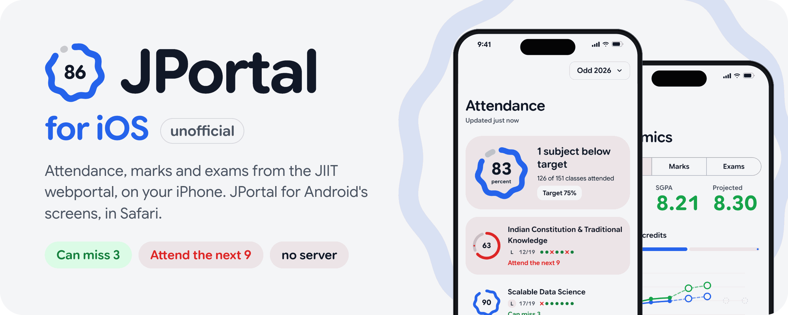
  </picture>
</p>

<p align="center">
  <a href="LICENSE"></a>
  
  
  
</p>

The JIIT webportal, as JPortal, on an iPhone. You sign in to the portal in Safari with Google as usual, and a
small script swaps the page for a faithful web remake of [JPortal for Android](https://github.com/codelif/jportal-android).
No app to sideload, no server in the middle: everything stays on your phone.

**On Android?** Get the real thing: [JPortal for Android](https://github.com/codelif/jportal-android)
([F-Droid](https://f-droid.org/packages/in.codelif.jportal.android/),
[Google Play](https://play.google.com/store/apps/details?id=in.codelif.jportal.android)).

Unofficial. Not affiliated with or endorsed by JIIT.

<p align="center">
  <a href="#get-started"><picture><source media="(prefers-color-scheme: dark)" srcset="docs/images/get-started-button-dark.png"></picture></a>
</p>

## What you get

<p align="center">
  <picture><source media="(prefers-color-scheme: dark)" srcset="docs/images/screen-attendance-dark.png">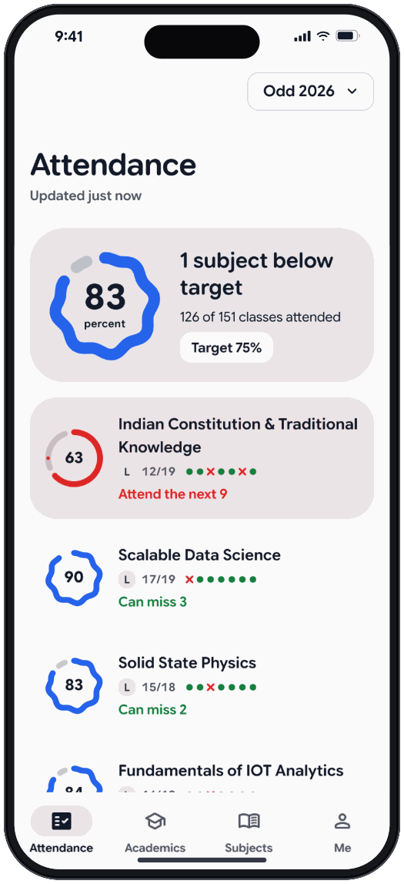</picture>
  <picture><source media="(prefers-color-scheme: dark)" srcset="docs/images/screen-subject-dark.png">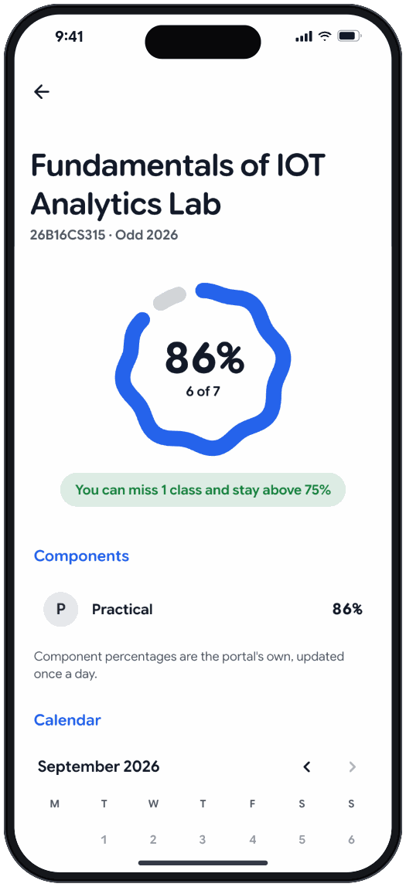</picture>
  <picture><source media="(prefers-color-scheme: dark)" srcset="docs/images/screen-overview-dark.png">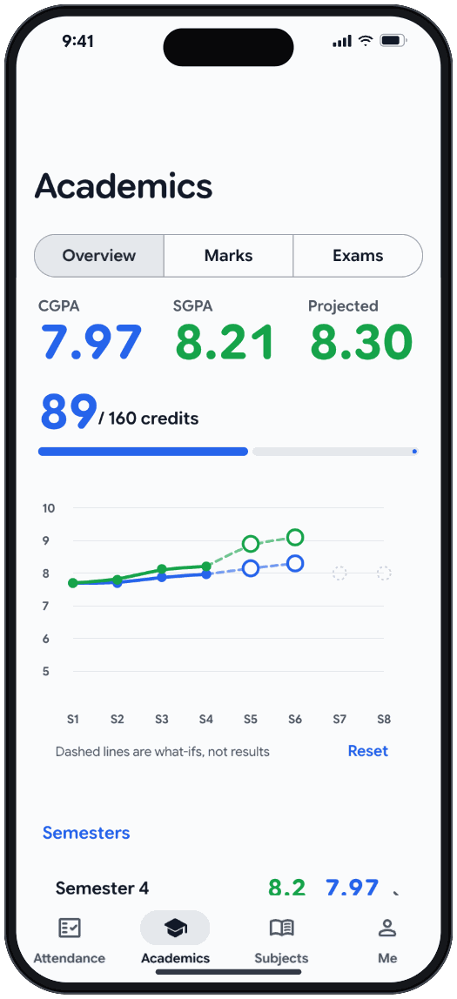</picture>
  <picture><source media="(prefers-color-scheme: dark)" srcset="docs/images/screen-calculator-dark.png">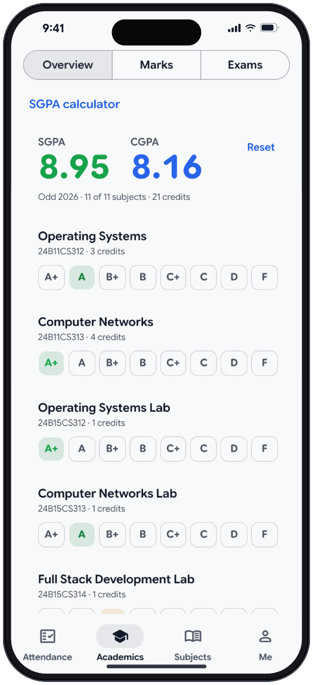</picture>
</p>
<p align="center">
  <picture><source media="(prefers-color-scheme: dark)" srcset="docs/images/screen-marks-dark.png">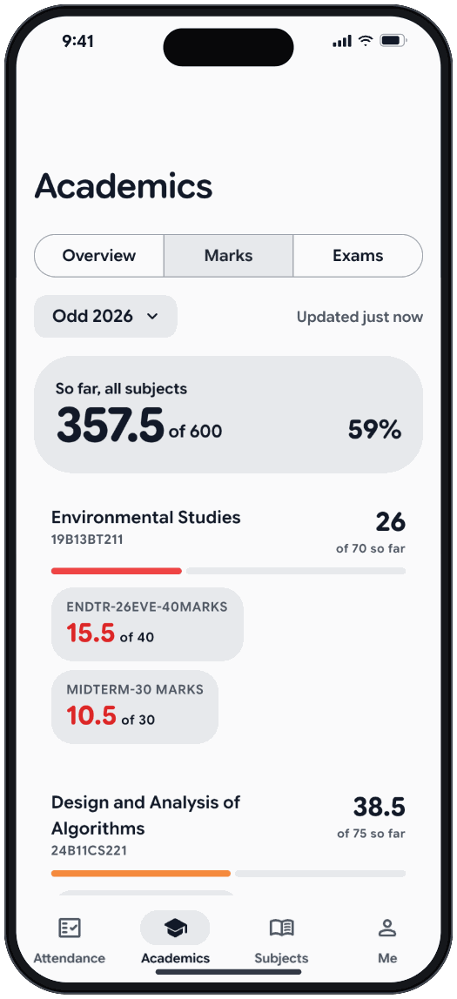</picture>
  <picture><source media="(prefers-color-scheme: dark)" srcset="docs/images/screen-exams-dark.png">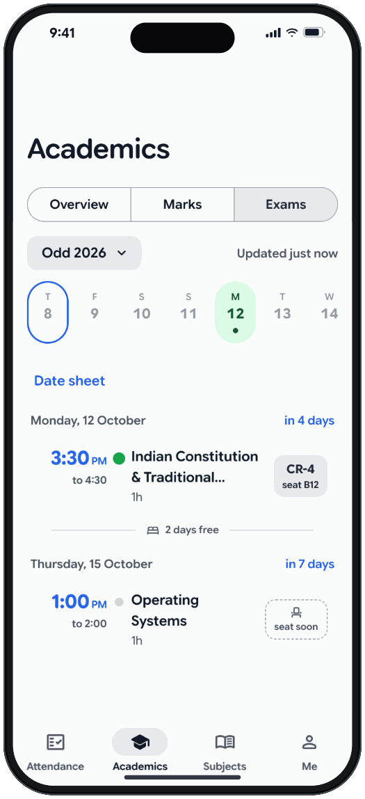</picture>
  <picture><source media="(prefers-color-scheme: dark)" srcset="docs/images/screen-subjects-dark.png">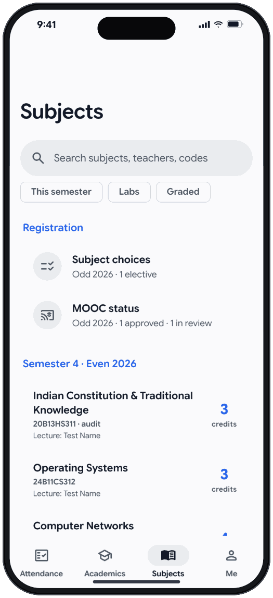</picture>
  <picture><source media="(prefers-color-scheme: dark)" srcset="docs/images/screen-me-dark.png">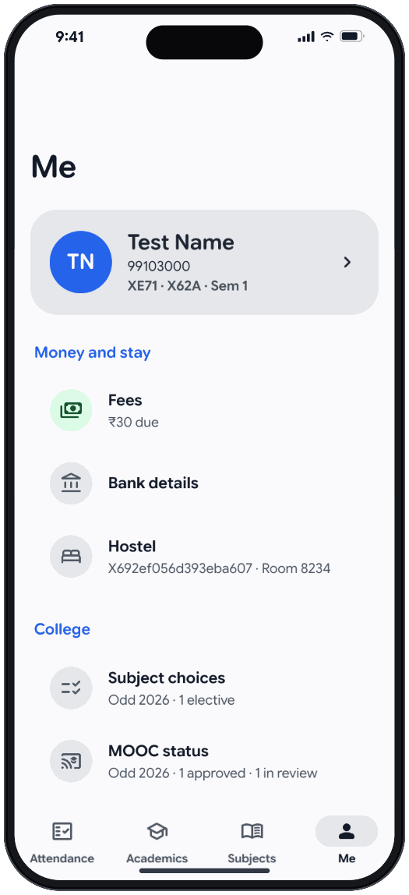</picture>
</p>

- attendance, counted class by class
- how many classes you can miss, or need to attend (still the actual reason you are here)
- every subject's classes on a calendar, so you can see which Monday it all went wrong
- exam schedule with rooms, seats and a countdown (still nobody asked for the countdown)
- SGPA, CGPA, grade cards and marks (viewer discretion still advised)
- a CGPA what-if for the semesters to come, and an SGPA calculator for this one (hope is still free)
- your profile, fees, hostel, subject choices and MOOCs, without the portal's twelve dropdowns
- the last numbers you saw, even when the portal is down (which is often)
- light and dark, the way your phone is set

Screenshots use demo data, not a real student.

## Get started

Three short guides. **Tap a card to open it.** New here? Start with 1.

<details>
<summary><picture><source media="(prefers-color-scheme: dark)" srcset="docs/images/guide-1-install-dark.png"></picture></summary>
<br>

You need an iPhone, Safari and your JIIT Google account. You only do this once.

#### Step 1 · Get Userscripts

Install **[Userscripts](https://apps.apple.com/app/userscripts/id1463298887)** from the App Store. It's free and
[open source](https://github.com/quoid/userscripts), and it's what runs JPortal inside Safari.

<p align="center"><picture><source media="(prefers-color-scheme: dark)" srcset="docs/images/step-1-get-userscripts-dark.png">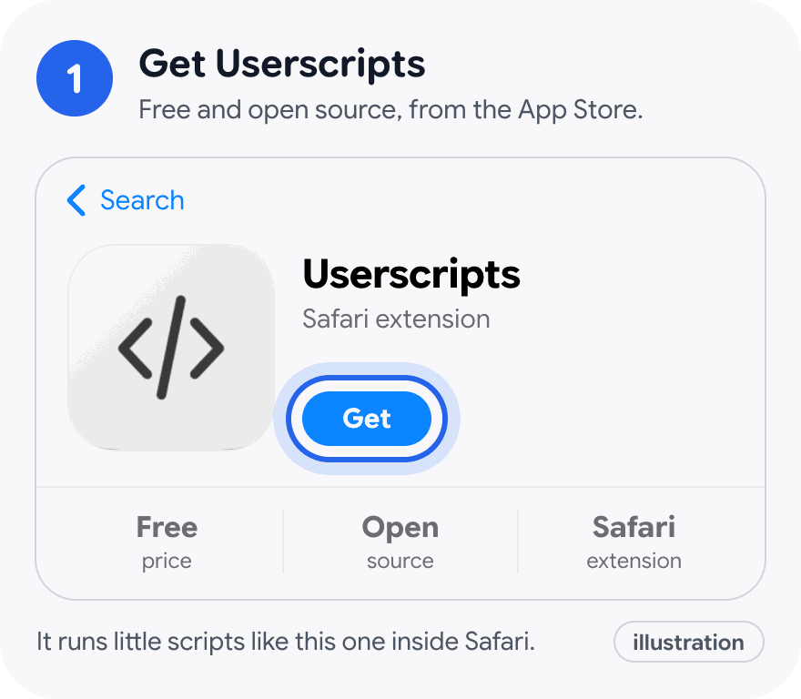</picture></p>

#### Step 2 · Open it once and pick a folder

Open the Userscripts app and tap **Change Userscripts Directory**. Pick a folder for your scripts (the one it
suggests is fine) and tap **Open**. Userscripts won't install anything until it has a folder.

<p align="center"><picture><source media="(prefers-color-scheme: dark)" srcset="docs/images/step-2-pick-folder-dark.png">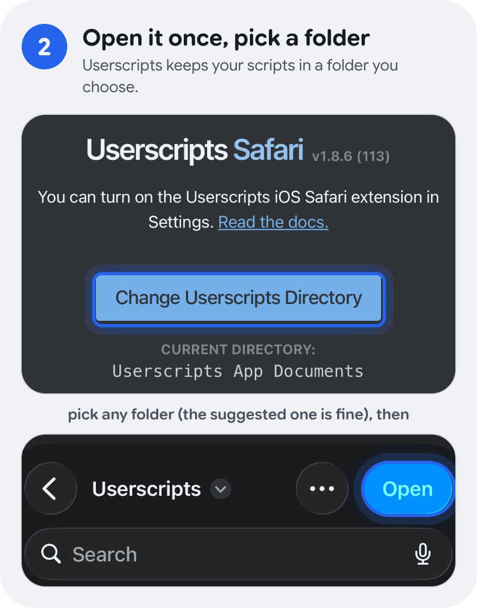</picture></p>

#### Step 3 · Turn it on in Safari

Open the **Settings** app › **Apps** › **Safari** › **Extensions** (on older iOS: Settings › Safari ›
Extensions). Tap **Userscripts** and switch on **Allow Extension**.

<p align="center"><picture><source media="(prefers-color-scheme: dark)" srcset="docs/images/step-3-turn-it-on-dark.png">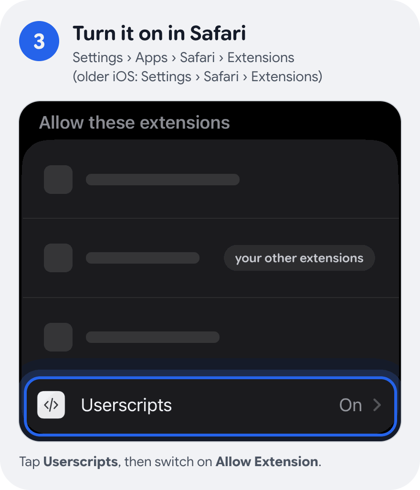</picture></p>

#### Step 4 · Let it run on websites

On the same Userscripts screen, scroll down to **Permissions**. Tap **Other Websites** and choose **Allow**.
If it says **Ask**, JPortal can't start on its own.

<p align="center"><picture><source media="(prefers-color-scheme: dark)" srcset="docs/images/step-4-allow-websites-dark.png">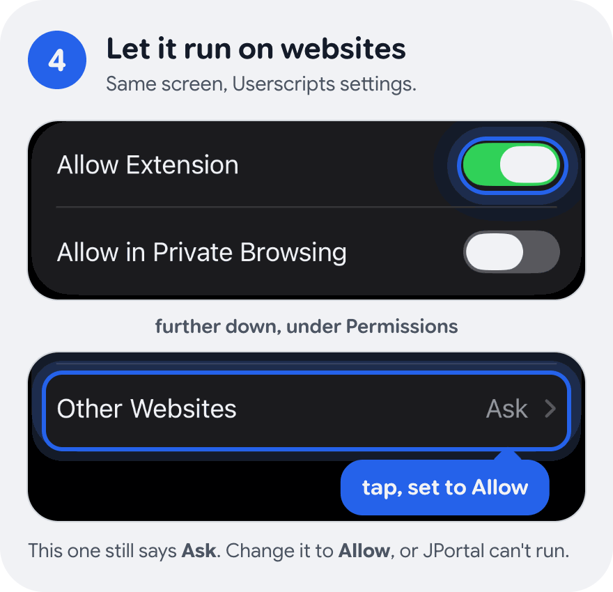</picture></p>

#### Step 5 · Install JPortal

Open this page in **Safari** (not inside the GitHub app), then tap:

<p align="center">
  <a href="https://raw.githubusercontent.com/iAnmolAgarwal/jportal-ios/main/dist/jportal.user.js"><picture><source media="(prefers-color-scheme: dark)" srcset="docs/images/install-button-dark.png"></picture></a>
</p>

Safari shows a page of code. That's the script, and it's meant to look like that. Then:

1. Tap the **page icon with the puzzle piece**, on the left of the address bar.
2. Tap **Userscripts**.
3. The Userscripts menu says **Userscript Detected: Tap to install**. Tap it, then tap **Install**.

<p align="center"><picture><source media="(prefers-color-scheme: dark)" srcset="docs/images/step-5-install-dark.png">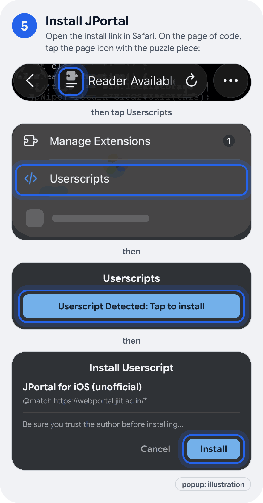</picture></p>

<details>
<summary><b>Didn't work? Save the file yourself instead</b></summary>
<br>

1. Open the [install link](https://raw.githubusercontent.com/iAnmolAgarwal/jportal-ios/main/dist/jportal.user.js)
   in Safari. Tap **Share** › **Save to Files**. You can also download `jportal.user.js` from this repo
   (`dist/jportal.user.js`) or from someone's AirDrop.
2. Save it into the folder you picked in step 2. The file has to end in `.user.js`.

<p align="center"><picture><source media="(prefers-color-scheme: dark)" srcset="docs/images/step-file-dark.png">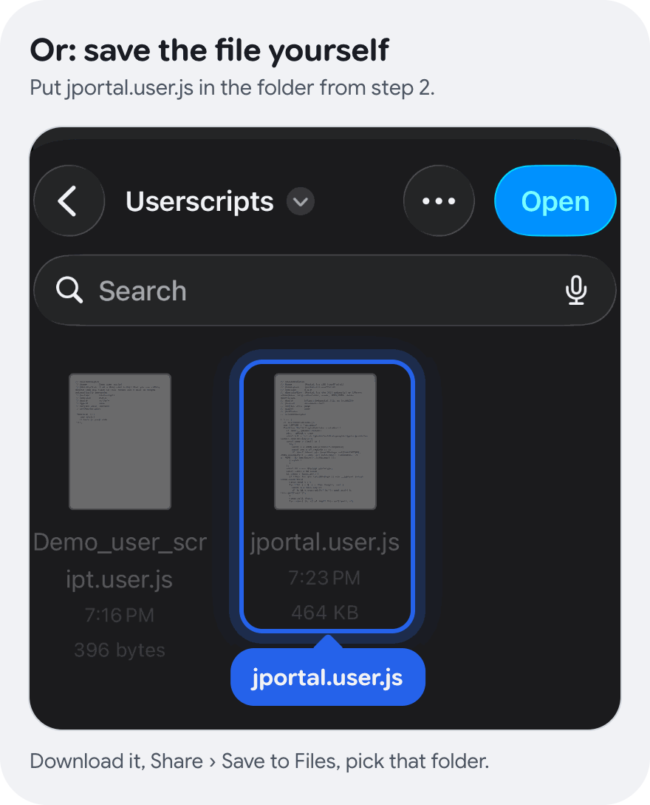</picture></p>

Keep just one copy. If the folder ends up with both `jportal.user.js` and `JPortal for iOS (unofficial).user.js`,
delete one, or both copies will run.

</details>

#### Step 6 · Sign in to the portal

Open **[webportal.jiit.ac.in:6011/studentportal](https://webportal.jiit.ac.in:6011/studentportal/)** in
Safari. Leave **Student** selected and tap **Sign in with Google**, the same way you always do.

<p align="center"><picture><source media="(prefers-color-scheme: dark)" srcset="docs/images/step-6-sign-in-dark.png">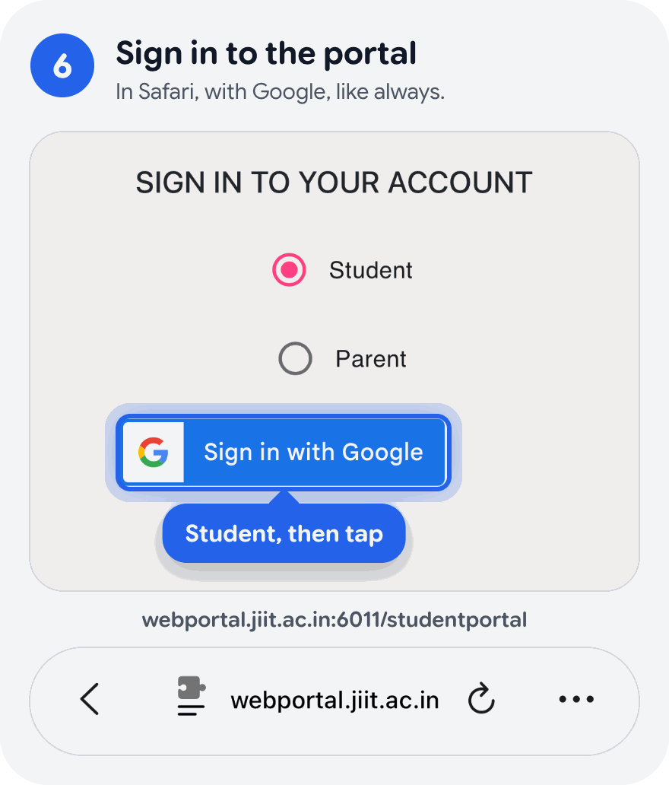</picture></p>

#### Step 7 · That's it

JPortal takes over as soon as the portal signs you in. Still seeing the portal's own page? Reload it once
(pull down, or tap ↻ in the address bar).

<p align="center"><picture><source media="(prefers-color-scheme: dark)" srcset="docs/images/step-7-jportal-dark.png">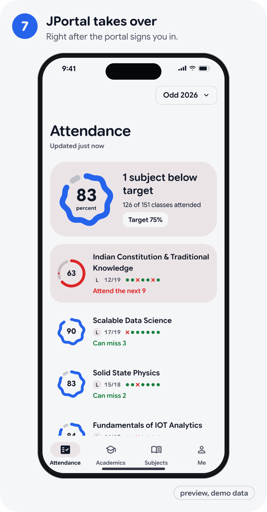</picture></p>

**Next:** put it on your Home Screen so it opens in one tap, like an app (guide 2 below).

</details>

<details>
<summary><picture><source media="(prefers-color-scheme: dark)" srcset="docs/images/guide-2-home-dark.png">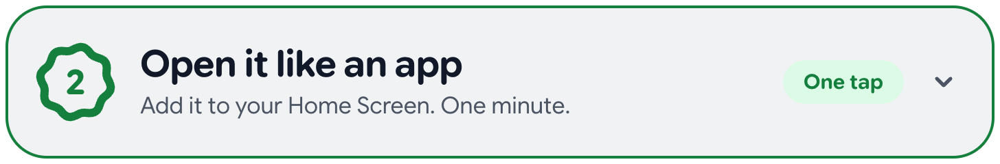</picture></summary>
<br>

One minute, once. After this, JPortal is one tap away from your Home Screen.

1. Open the portal in **Safari** and sign in, so you're looking at JPortal. Tap **•••** (bottom right of
   Safari), then **Share**. On older iOS, **Share** is right in Safari's toolbar.
2. Scroll down the share sheet and tap **Add to Home Screen**.
3. Switch **Open as Web App** **off**. Rename it **JPortal** if you like. Tap **Add**.

<p align="center">
  <picture><source media="(prefers-color-scheme: dark)" srcset="docs/images/home-1-share-dark.png">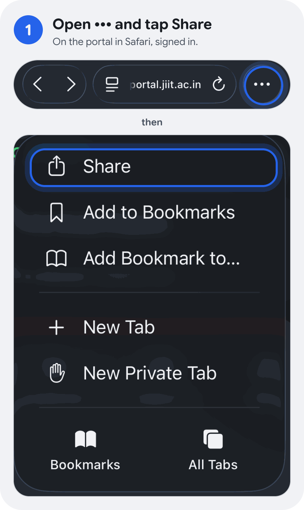</picture>
  <picture><source media="(prefers-color-scheme: dark)" srcset="docs/images/home-2-add-dark.png">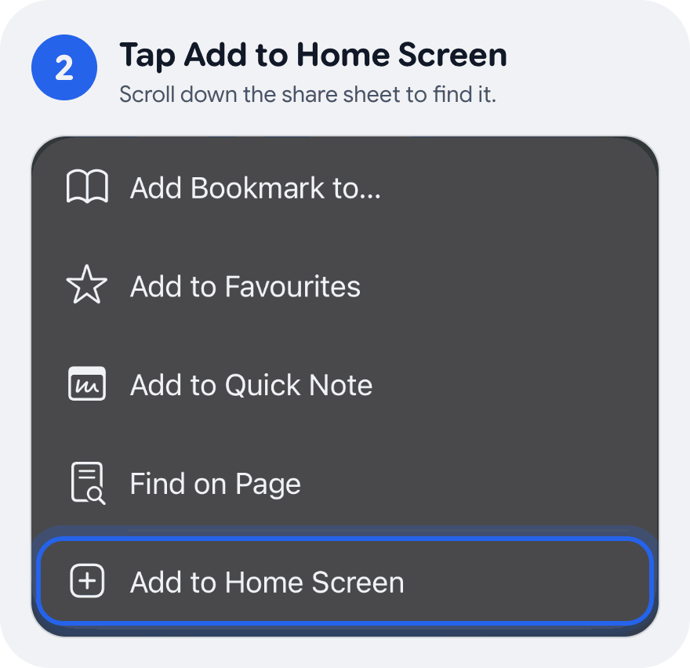</picture>
  <picture><source media="(prefers-color-scheme: dark)" srcset="docs/images/home-3-name-dark.png">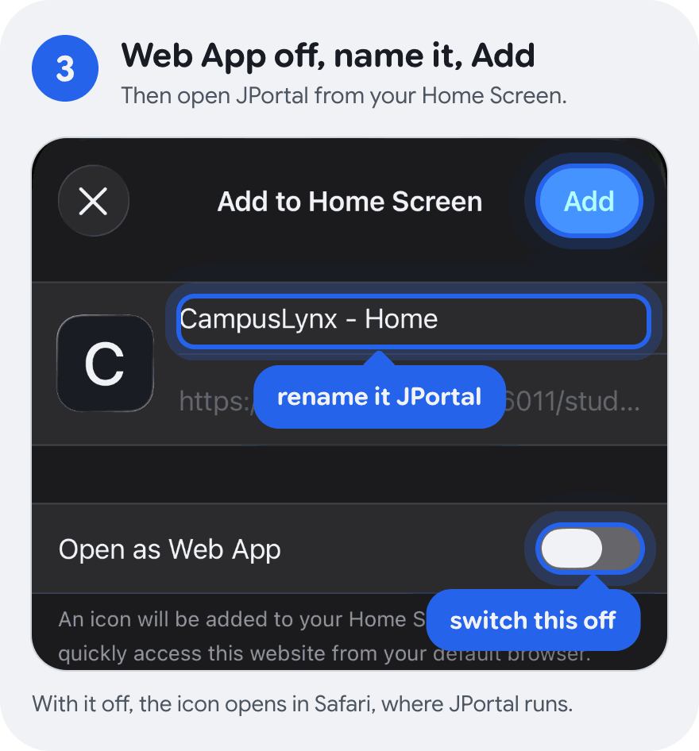</picture>
</p>

> **Open as Web App must be off.** A web app opens outside Safari, where Userscripts can't run, so you'd just
> get the plain portal. With it off, the icon opens the portal in Safari and JPortal runs. Don't see the
> switch (older iOS)? Just tap **Add**.

> **Tapped the icon and got the plain portal?** Reload the page (pull down, or tap ↻ in the address bar).
> JPortal takes over after the reload.

The icon opens your **default browser**. If that's Chrome or another browser, either make Safari the default
(Settings › Apps › Safari › **Default Browser App**) or skip the icon and use **Share** › **Add to Favourites**
in Safari instead.

</details>

<details>
<summary><picture><source media="(prefers-color-scheme: dark)" srcset="docs/images/guide-3-fix-dark.png">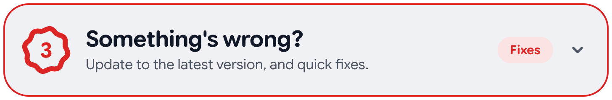</picture></summary>
<br>

#### Seeing the plain portal instead of JPortal? Reload.

Pull down on the page, or tap ↻ in the address bar. That fixes it most of the time, especially right after
opening JPortal from the Home Screen icon. Still the plain portal? See **Other problems** below.

#### Every screen says "Couldn't load this"? Get the latest version.

The JIIT portal changes now and then, and that can break JPortal until a fixed version is out. Fixes usually
land within a few days. Installing the latest version is all you need to do:

1. Open the install link in Safari:
   <p><a href="https://raw.githubusercontent.com/iAnmolAgarwal/jportal-ios/main/dist/jportal.user.js"><picture><source media="(prefers-color-scheme: dark)" srcset="docs/images/install-button-dark.png"></picture></a></p>
2. On the page of code, tap the **page icon with the puzzle piece** (left of the address bar), then
   **Userscripts**.
3. This time it says **Userscript Installed: Tap to re-install**. Tap it, then **Install**. That replaces your
   copy with the newest one.
4. Go back to the portal and reload it.

<p align="center"><picture><source media="(prefers-color-scheme: dark)" srcset="docs/images/step-update-dark.png">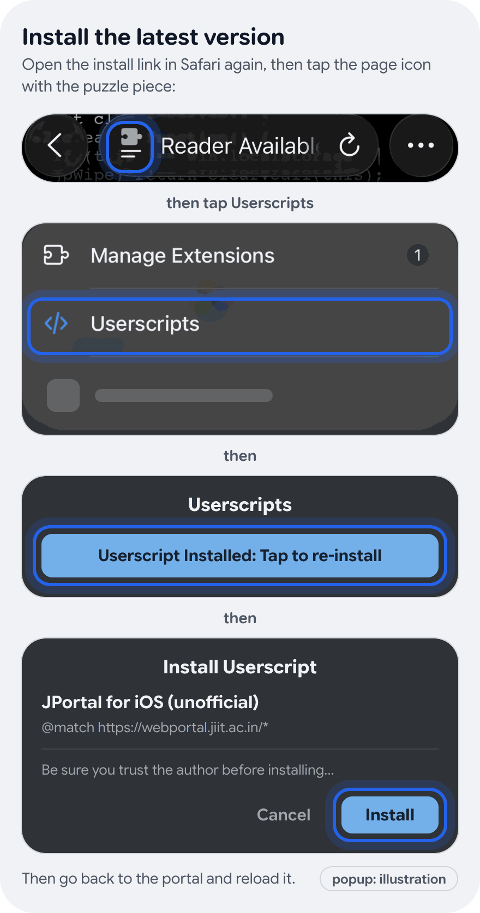</picture></p>

Your settings, your sign-in and the Home Screen icon all stay as they are. You can also update from the
Userscripts menu on any page: tap its **updates** button, then **Check Updates**.

What's in each version: [Releases](https://github.com/iAnmolAgarwal/jportal-ios/releases). To hear about
fixes as soon as they're out, tap **Watch** › **Custom** › **Releases** at the top of this page (needs a GitHub
account). Right after a release, GitHub can take about 5 minutes to serve the new file.

If you first installed by saving the file yourself, delete that `jportal.user.js` (in the Files app, or with
the trash button in the Userscripts list) before installing from the link, so you don't end up with two.

Updated and it's still broken? Check the [open issues](https://github.com/iAnmolAgarwal/jportal-ios/issues)
in case someone has already reported it, or open a new one.

#### Other problems

<details>
<summary><b>I signed in, but it's still the normal portal</b></summary>
<br>

<p align="center"><picture><source media="(prefers-color-scheme: dark)" srcset="docs/images/help-check-script-dark.png">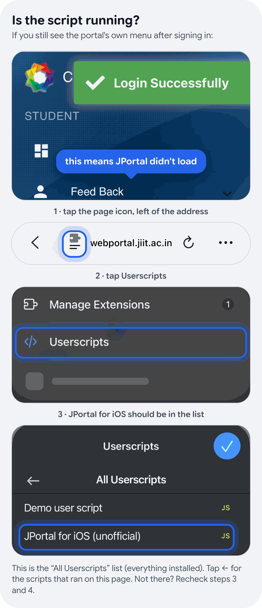</picture></p>

Go through these in order:

1. **Reload the page.** Pull down on the portal page, or tap the reload arrow in the address bar.
2. **Is Userscripts allowed?** Settings › Apps › Safari › Extensions › Userscripts: **Allow Extension** is on,
   and **Other Websites** (or webportal.jiit.ac.in) is set to **Allow**, not **Ask**. See steps 3 and 4 of
   guide 1.
3. **Is the script installed?** On the portal, tap the page icon (left of the address bar) › **Userscripts**. If the list says
   **All Userscripts**, that's every script you have installed. Tap **←** to see the scripts that matched
   this page. JPortal for iOS should be there.
4. **Is it the latest version?** Install it again (see the update steps above).

</details>

<details>
<summary><b>The Home Screen icon doesn't open JPortal</b></summary>
<br>

- **It opens without Safari's address bar:** it was added as a web app, where Userscripts can't run. Delete the
  icon and add it again with **Open as Web App** switched off (guide 2).
- **It opens in Chrome or another browser:** the icon uses your default browser. Make Safari the default
  (Settings › Apps › Safari › **Default Browser App**), or use a Safari Favourite instead.
- **It opens in Safari, but it's the plain portal:** reload the page.

</details>

<details>
<summary><b>It says "Sign out and sign in again once so JPortal can pick up your student id"</b></summary>
<br>

JPortal reads your student id at the moment you sign in. If you installed it while you were already signed
in, it missed that moment. Open **Me** › **Settings** › **Sign out**, then sign in with Google again. You only
need to do this once.

</details>

<details>
<summary><b>Marks don't open, or say they need iOS 16.4+</b></summary>
<br>

The portal sends marks as a PDF, and reading it needs a Safari feature that arrived in iOS 16.4. Everything
else works on older iOS. Update iOS (Settings › General › Software Update) to get marks.

</details>

<details>
<summary><b>The Userscripts menu says "Open Userscripts App to complete the initialization"</b></summary>
<br>

Userscripts doesn't have a scripts folder yet. Do step 2 of guide 1 (open the app and pick a folder), then try
the install again.

</details>

<details>
<summary><b>I use Chrome (or another browser) on my iPhone</b></summary>
<br>

Only Safari runs extensions on iPhone, so JPortal works in Safari only. Your Google sign-in works fine there.

On a computer it runs anywhere with a userscript manager: Chrome, Edge or Firefox with
[Tampermonkey](https://www.tampermonkey.net/) or [Violentmonkey](https://violentmonkey.github.io/), or Safari on
a Mac with Userscripts. Install the manager, then open the
[install link](https://raw.githubusercontent.com/iAnmolAgarwal/jportal-ios/main/dist/jportal.user.js).

</details>

<details>
<summary><b>It doesn't work in Private Browsing</b></summary>
<br>

Private tabs need their own permission: Settings › Apps › Safari › Extensions › Userscripts ›
**Allow in Private Browsing**.

</details>

Still stuck? [Open an issue](https://github.com/iAnmolAgarwal/jportal-ios/issues) and say what you see. Don't
post screenshots that show your name, enrollment number or marks.

</details>

## Privacy

- **No server.** The script runs on the portal's own page and talks only to the portal, the same way the
  portal's own website does. There's no JPortal server or proxy, and nobody else sees your data.
- **No analytics, no tracking, no ads.**
- **Data stays on your phone.** The last numbers you saw are cached in the portal page's own storage in Safari,
  so they show up when the portal is slow or down. **Me** › **Settings** › **Sign out** clears all of it.
- **You can read it.** It's one file, [`dist/jportal.user.js`](dist/jportal.user.js), built from the code in
  [`src/`](src).

## For developers

<details>
<summary><b>How it works</b></summary>
<br>

The portal keeps your session in its own page storage. The script runs on the portal's own address, so it can
call the same API the portal does, with the same request headers, ported from
[ktjiit](https://github.com/codelif/ktjiit). Then it draws JPortal's screens over the page, in a shadow root so
the portal's styles don't leak in. Marks come as a PDF, which a small parser (also ported from ktjiit) reads
on the phone.

A few calls need your student id, and the portal only keeps that in memory. So the script reads it from the
login response as it happens. That's why installing while signed in needs one sign-out and sign-in.

</details>

<details>
<summary><b>Build and test</b></summary>
<br>

Node 20 or newer.

```sh
npm install
node build.mjs              # dist/jportal.user.js (the install file) + the desktop preview
node tools/serve.mjs        # http://localhost:5179/dist/preview.html, the real app on fixture data
npm test                    # request crypto vectors, marks PDF parser goldens, portal transport
```

Preview options like `?tab=academics&theme=dark&now=2026-09-24` are listed in
[CONTRIBUTING.md](CONTRIBUTING.md), along with the screenshot tool and the ground rules. The README images are
made by the scripts in [`docs/tools/`](docs/tools). How a fix gets to everyone's phone: [RELEASING.md](RELEASING.md).

</details>

## Credits

This is a port. Everything good about it comes from:

- [JPortal for Android](https://github.com/codelif/jportal-android) and [ktjiit](https://github.com/codelif/ktjiit)
  by [codelif](https://github.com/codelif) (Harsh Sharma). The screens, copy, colours, icons and attendance
  maths are carried over from the Android app, and the portal client from ktjiit.
- The original [JPortal](https://github.com/codeblech/jportal) by [Yash Malik](https://github.com/codeblech)
  (codeblech), whose design and spirit both apps carry forward.
- Protocol groundwork from [jsjiit](https://github.com/codeblech/jsjiit) and [pyjiit](https://github.com/codelif/pyjiit).
- [Userscripts](https://github.com/quoid/userscripts) by quoid, which makes userscripts possible in iOS Safari.
- Google Sans Flex (SIL Open Font License) and Material Symbols (Apache 2.0) by Google.

iOS port by Anmol Agarwal ([@iAnmolAgarwal](https://github.com/iAnmolAgarwal)). See [NOTICE](NOTICE).

## License

[GPL-3.0-only](LICENSE)

Unofficial. Not affiliated with or endorsed by JIIT.
